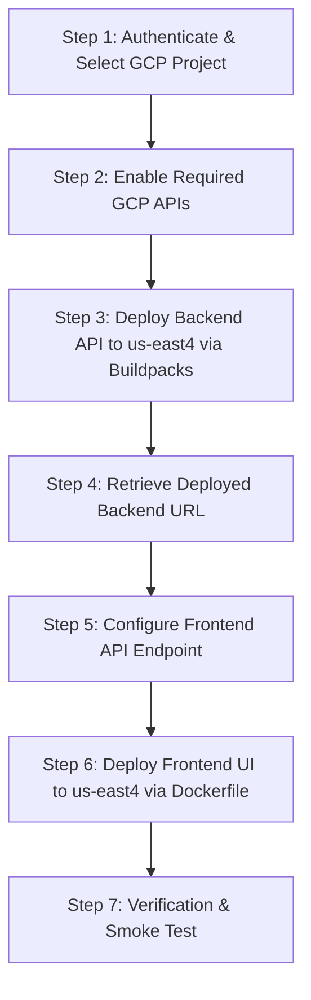

# Step-by-Step Cloud Run Deployment Plan: AI Fitness Coach

**Document ID:** `2026-10-28-cloud-run-deployment-plan`  
**Date:** 2026-10-28  
**Target Region:** `us-east4` (Northern Virginia)  
**Status:** Pending User Review  

---

## 1. Architecture & Service Inventory

The application consists of two decoupled components located in `C:\Users\stavr\source\repos\AI Fitness Coach`:

| Service | Directory | Tech Stack | Deployment Strategy | Cloud Run Service Name |
| :--- | :--- | :--- | :--- | :--- |
| **Backend API** | `FitnessApp.Api/FitnessApp.Api/` | C# ASP.NET Core (.NET 10 / Web API) | Cloud Run Buildpacks (`--source .`) | `fitness-coach-api` |
| **Frontend UI** | `fitness-app-ui/` | Angular 21 (Standalone components) | Multi-stage Dockerfile + Nginx Alpine | `fitness-coach-ui` |

---

## 2. Configuration Adjustments Completed

### A. C# ASP.NET Core API Configuration (Cloud Run Buildpacks)
The file `FitnessApp.Api/FitnessApp.Api/Program.cs` has been updated to satisfy Cloud Run buildpack requirements:
1. **Dynamic Port Binding**: Configured Kestrel to dynamically bind to `0.0.0.0:${PORT:-8080}` as required by the Cloud Run container runtime contract.
2. **CORS Flexibility**: Updated CORS policy `AllowAngularApp` to permit cross-origin calls from Cloud Run hosted origins.
3. **SSL Redirection Safeguard**: Guarded `app.UseHttpsRedirection()` so it only runs outside production. In Cloud Run, Google Cloud terminates TLS at the ingress load balancer and forwards plain HTTP to the container; bypassing redirection avoids health check probe failures and redirect loops.
4. **Health Check Probe**: Added a lightweight root `/` probe returning `200 OK` for container readiness verification.

### B. Angular Frontend Containerization
The following production files have been created in `fitness-app-ui/`:
1. **`fitness-app-ui/Dockerfile`**:
   - Multi-stage build leveraging `node:20-alpine` to compile the Angular application via `@angular/build:application` into `/app/dist/fitness-app-ui/browser`.
   - Lightweight production stage using `nginx:alpine` to serve static assets and handle routing.
   - Container listens on port `8080` (Cloud Run default).
2. **`fitness-app-ui/nginx.conf`**:
   - Handles client-side Single Page Application (SPA) routing with `try_files $uri $uri/ /index.html;`.
   - Configures asset caching headers for fast delivery.
3. **`fitness-app-ui/.dockerignore`**:
   - Excludes `node_modules`, `.angular`, `.git`, and build caches from the build context to accelerate image uploads.

---

## 3. Step-by-Step Deployment Procedure



### Step 1: GCP Authentication and Project Setup
Run the following in PowerShell:
```powershell
# Authenticate with Google Cloud
gcloud auth login

# Set your active GCP project ID
gcloud config set project [YOUR_PROJECT_ID]

# Set default region to us-east4
gcloud config set run/region us-east4
```

### Step 2: Enable Required Cloud APIs
Ensure Google Cloud Run, Cloud Build, and Artifact Registry are active:
```powershell
gcloud services enable run.googleapis.com cloudbuild.googleapis.com artifactregistry.googleapis.com
```

### Step 3: Deploy C# ASP.NET Core API via Buildpacks
Deploy the backend directly from its project root using Cloud Buildpacks (no manual Dockerfile needed):
```powershell
cd "C:\Users\stavr\source\repos\AI Fitness Coach\FitnessApp.Api\FitnessApp.Api"

gcloud run deploy fitness-coach-api `
  --source . `
  --region us-east4 `
  --platform managed `
  --allow-unauthenticated `
  --set-env-vars ASPNETCORE_ENVIRONMENT=Production
```
*Note the generated Service URL from the command output (e.g., `https://fitness-coach-api-xxxxxxxx-uk.a.run.app`).*

### Step 4: Configure Frontend API Target
Update the Angular `CoachService` endpoint (`fitness-app-ui/src/app/services/coach.ts`) to point to your deployed Cloud Run backend URL rather than `https://localhost:7020`.

### Step 5: Deploy Angular Frontend via Dockerfile
Deploy the frontend container to Cloud Run in `us-east4`:
```powershell
cd "C:\Users\stavr\source\repos\AI Fitness Coach\fitness-app-ui"

gcloud run deploy fitness-coach-ui `
  --source . `
  --region us-east4 `
  --platform managed `
  --allow-unauthenticated
```

### Step 6: Verify Deployment
1. Open the backend health check: `https://fitness-coach-api-xxxxxxxx-uk.a.run.app/`
2. Open the frontend URL: `https://fitness-coach-ui-xxxxxxxx-uk.a.run.app/`
3. Generate a workout in the UI to confirm seamless frontend-to-backend communication.

